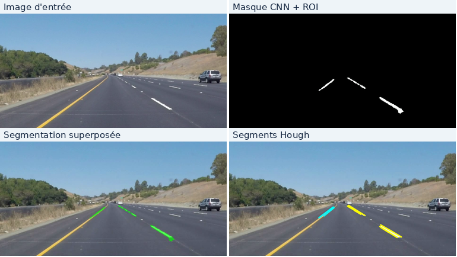

# Lane Detection with U-Net and OpenCV

C++20 implementation of lane-marking segmentation and line-segment extraction using LibTorch and OpenCV. Developed as an embedded vision project in Mechatronics and Automotive Technologies at ENSA Agadir.



## Method

The video frames are resized and normalized before inference with a compact U-Net. The predicted probability map is thresholded at 0.5, restricted to a trapezoidal region of interest, and processed using the probabilistic Hough transform to extract candidate line segments.

The Hough output represents detected segments, not a validated lane model or a steering command.

## Results

The trained model was evaluated on a held-out test set of 350 images from the PSU Reservoir Lane Dataset.

| Metric | Result |
| --- | ---: |
| IoU | 0.626396 |
| Dice coefficient | 0.770287 |
| Precision | 0.730292 |
| Recall | 0.814916 |
| Test loss | 0.302047 |

These are the best results obtained in this project. They are specific to the test split and evaluation settings.

For the 681-frame demonstration video (960 x 540, 25 fps), the measured end-to-end throughput was 28.23 frames/s (24.12 s total), including generation of three output videos. Internal processing averaged 21.90 ms/frame, excluding output encoding. Measurements were obtained on an Intel Core i7-13620H using CPU inference. These measurements do not establish deterministic real-time performance.

## Requirements

- Linux with a C++20 compiler and CMake
- OpenCV 4 development libraries
- LibTorch CPU, installed at `$HOME/opt/libtorch` or specified through `LIBTORCH_DIR`

On Ubuntu:

```bash
sudo apt update
sudo apt install -y build-essential cmake pkg-config libopencv-dev
```

Install a compatible CPU distribution of LibTorch from the [PyTorch website](https://pytorch.org/get-started/locally/).

## Build and run

```bash
chmod +x run_demo.sh
./run_demo.sh
```

To use another LibTorch installation:

```bash
LIBTORCH_DIR=/absolute/path/to/libtorch ./run_demo.sh
```

The script builds the `infer_video` executable and processes `data/videos/solidYellowLeft.mp4`. Generated videos are saved to `reports/videos/`:

- `lane_mask.avi`: segmentation mask
- `lane_overlay.avi`: segmentation overlay
- `lane_hough_segments.avi`: detected line segments

The full training dataset is not included. The checkpoint in `checkpoints/` is sufficient to run the demonstration; training and evaluation require the dataset separately.

## Project files

```text
lane-detection-unet-cpp/
├── CMakeLists.txt
├── README.md
├── run_demo.sh
├── include/lane/
├── src/
├── checkpoints/
│   ├── lane_unet.pt
│   └── lane_unet.pt.cfg
├── data/videos/solidYellowLeft.mp4
├── figures/
├── demo_hough.mp4
└── demo_masque.mp4
```

## Data sources

- **PSU Reservoir Lane Dataset:** [dataset page](https://huggingface.co/datasets/kim2548TH/psu-reservoir-lane-dataset). Used for training and quantitative evaluation; dataset files are not distributed in this repository.
- **Demonstration video:** [`solidYellowLeft.mp4`](https://github.com/udacity/CarND-LaneLines-P1/blob/master/test_videos/solidYellowLeft.mp4) from [Udacity's CarND-LaneLines-P1](https://github.com/udacity/CarND-LaneLines-P1). Credit: Udacity. Used only for qualitative demonstration.

## Limitations

The implementation has not been validated on a real vehicle. The extracted segments are not tracked across frames, and the demonstration video does not provide ground-truth labels for quantitative evaluation.
